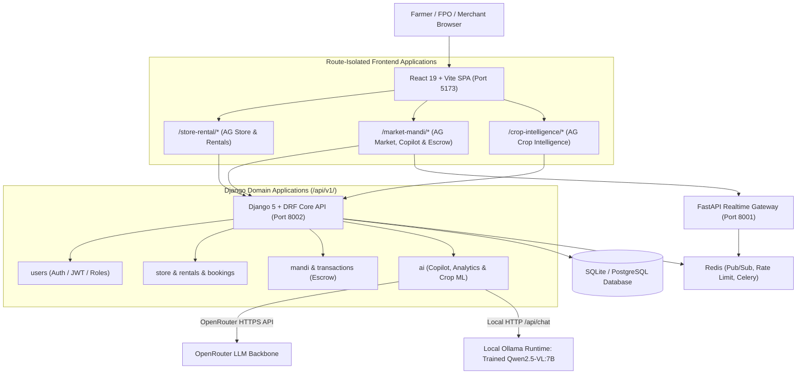
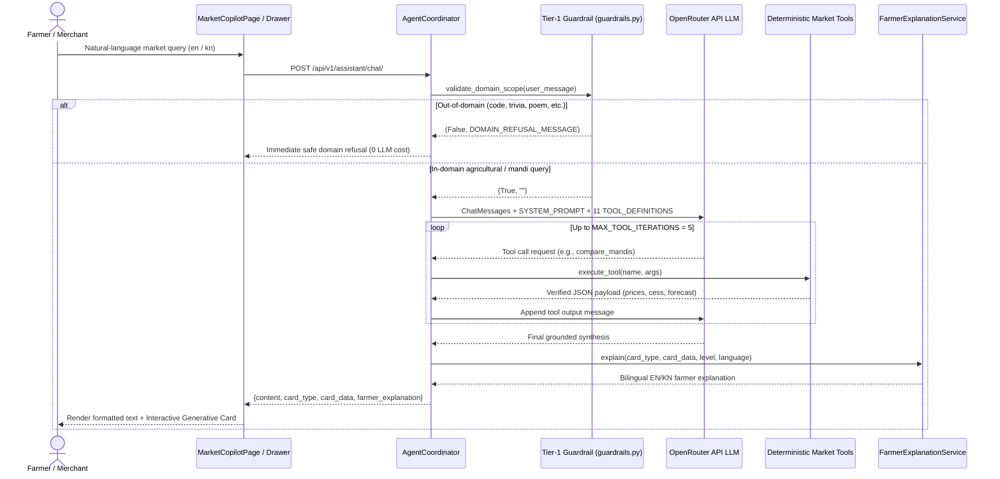
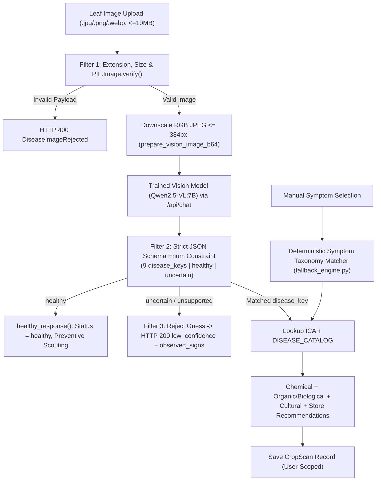
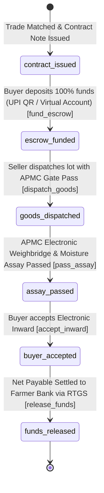
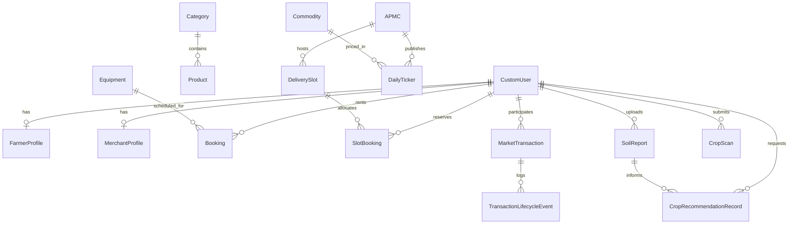

# AI-Based Crop Recommendation, Yield Prediction and Market Price Risk Analysis for Farmers
### **AgriMart — Integrated Agricultural Marketplace, Agentic Mandi Copilot, and Crop Intelligence Platform**

---

> **A MINOR PROJECT REPORT**  
> *Submitted to*  
> **THE NATIONAL INSTITUTE OF ENGINEERING, MYSURU**  
> *(An Autonomous Institute under Visvesvaraya Technological University, Belagavi)*  
> *in partial fulfillment for the award of the degree of*  
> **Bachelor of Engineering**  
> *in*  
> **Computer Science and Engineering (AI & ML)**

**Submitted By:**

| Name | USN |
| :--- | :--- |
| **Darshan V** | 4NI24CI035 |
| **Dhanush M** | 4NI24CI038 |
| **Gandham Raja Reddy** | 4NI24CI044 |
| **Harsha D K** | 4NI24CI048 |

**Under the Guidance of:**  
**Divyashree R**  
Assistant Professor, Department of Computer Science & Engineering  
The National Institute of Engineering, Mysuru – 570 008  

**Academic Year:** 2026–27

---

## CERTIFICATE

This is to certify that the project work entitled **“AI-Based Crop Recommendation, Yield Prediction and Market Price Risk Analysis for Farmers (AgriMart)”** is a bonafide work carried out by **Darshan V (4NI24CI035)**, **Dhanush M (4NI24CI038)**, **Gandham Raja Reddy (4NI24CI044)**, and **Harsha D K (4NI24CI048)** in partial fulfillment for the award of the degree of **Bachelor of Engineering in Computer Science and Engineering (AI & ML)** of Visvesvaraya Technological University, Belagavi, during the academic year 2026–27.

It is certified that all corrections and suggestions indicated during internal assessment have been incorporated, and the corrected copy has been deposited in the department library. This project report has been approved in partial fulfillment for the award of the said degree as per academic regulations of The National Institute of Engineering (Autonomous Institution).

| | |
| :--- | :--- |
| **Guide:** Divyashree R <br> Assistant Professor, Dept. of CS&E, NIE, Mysuru | **Head of Department:** Dr. Anitha R <br> Professor & Head, Dept. of CS&E, NIE, Mysuru |

**Examiners:**

1. Name: \_\_\_\_\_\_\_\_\_\_\_\_\_\_\_\_\_\_\_\_\_\_\_\_ Signature & Date: \_\_\_\_\_\_\_\_\_\_\_\_\_\_\_\_\_\_
2. Name: \_\_\_\_\_\_\_\_\_\_\_\_\_\_\_\_\_\_\_\_\_\_\_\_ Signature & Date: \_\_\_\_\_\_\_\_\_\_\_\_\_\_\_\_\_\_

---

## ABSTRACT

Indian agriculture supports the livelihoods of over half the national workforce, yet small and marginal farmers face persistent operational fragmentation across input procurement, machinery access, agronomic advisory, and post-harvest price realization. Farmers routinely switch between unverified local dealers, manual Agricultural Produce Market Committee (APMC) notice boards, paper-based Soil Health Cards (SHCs), and opaque credit or settlement intermediaries. To unify these disconnected workflows into a single verifiable digital ecosystem, **AgriMart** is engineered as a full-stack, multi-domain agricultural commerce, market intelligence, and precision crop advisory platform.

AgriMart is architected into three domain-isolated yet interoperable web applications sharing a unified security and persistence backbone: **(1) AG Store & Rentals**, **(2) AG Market & Mandi**, and **(3) AG Crop Intelligence**. The **AG Store & Rentals** module delivers an authenticated agricultural input marketplace (certified seeds, fertilizers, and crop-protection agents with inventory reservation safeguards) alongside an equipment rental hub supporting daily and per-acre tractor/machinery bookings with operator options and maintenance-status tracking.

The **AG Market & Mandi** module provides a live APMC commodity exchange terminal, daily price tickers, regional auction lots with real-time bidding throttled via Redis sliding-window rate limiters, weighbridge delivery slot reservations, and a six-stage **Escrow & Settlement Payment Gateway** supporting UPI QR, UPI ID, e-NAM Virtual Escrow Accounts, Netbanking, and Card checkout backed by SHA-256 tamper-evident lifecycle audit hashes. Central to this module is the **Agentic Market Intelligence Copilot**, orchestrated via the **OpenRouter API** and bounded by a strict two-tier domain guardrail filter and eleven read-only analytical tools. These tools execute deterministic net-proceeds calculations (accounting for 1.5% mandi cess, 0.5% escrow fee, freight, and moisture discounts), five-level order-book liquidity checks, Holt's linear trend 14-day price forecasting, institutional buyer matching, and bilingual (English and Kannada) farmer explanations rendered as interactive Generative UI cards.

The **AG Crop Intelligence** module integrates precision agronomy with vision-language pathology diagnostics. It provides ICAR-calibrated crop recommendation across NPK, pH, temperature, humidity, and rainfall inputs; Soil Health Card OCR supporting both photographed card extraction and human-in-the-loop parameter verification; user-scoped diagnostic history; and a **trained plant leaf disease recognition model (Qwen2.5-VL:7B)** coupled with structured JSON schema constraints, image validation filters, healthy/uncertain rejection gates, deterministic symptom-taxonomy lookup fallback, and AI-synthesized agronomic field briefs.

Built with **React 19, Vite, Tailwind CSS, Django 5, Django REST Framework, FastAPI, Redis, Celery, SQLite/PostgreSQL, and JWT authentication with Argon2 hashing**, AgriMart establishes an auditable, modular blueprint for technology-assisted agriculture—verified end-to-end by an automated test suite passing 34/34 unit, API, security, schema, and agentic-guardrail checks.

---

## ACKNOWLEDGEMENT

We express our sincere gratitude to all the individuals whose guidance, encouragement, and institutional support enabled the successful completion of this minor project.

We extend our heartfelt thanks to **Dr. B. S. Nagendra Parashar**, Principal, The National Institute of Engineering, Mysuru, for fostering a strong academic and research environment.

We are deeply grateful to **Dr. Anitha R**, Professor and Head, Department of Computer Science and Engineering, NIE, Mysuru, for her continuous support, valuable feedback, and encouragement throughout the tenure of this project.

We express our profound gratitude to our project guide, **Divyashree R**, Assistant Professor, Department of Computer Science and Engineering, NIE, Mysuru, for her insightful technical direction, patience, and constructive reviews at every stage of design, implementation, and verification.

Finally, we thank our faculty members, laboratory staff, peers, and families for their unwavering cooperation and encouragement.

- **Darshan V** (4NI24CI035)
- **Dhanush M** (4NI24CI038)
- **Gandham Raja Reddy** (4NI24CI044)
- **Harsha D K** (4NI24CI048)

---

## TABLE OF CONTENTS

- **Abstract**
- **Acknowledgement**
- **List of Figures**
- **List of Tables**
- **Chapter 1: Introduction**
  - 1.1 Background
  - 1.2 Problem Statement & Motivation
  - 1.3 Purpose
  - 1.4 Objectives
  - 1.5 Scope of the System
- **Chapter 2: Literature Survey**
  - 2.1 Digital Agriculture Ecosystems and e-NAM Market Integration
  - 2.2 Machine Learning and Rule-Based Crop Recommendation Systems
  - 2.3 Vision-Language Models and Deep Learning in Plant Disease Recognition
  - 2.4 Automated Soil Health Card Digitization and OCR Pipelines
  - 2.5 Agentic LLM Systems, Tool Grounding, and Domain Guardrails
  - 2.6 Time-Series Commodity Price Forecasting and Escrow Marketplaces
  - 2.7 Comparative Gap Analysis Matrix
- **Chapter 3: Existing System and Proposed System**
  - 3.1 Existing System and Limitations
  - 3.2 Proposed System (AgriMart)
  - 3.3 Comparative Analysis
- **Chapter 4: System Requirements Specification**
  - 4.1 Hardware Requirements
  - 4.2 Software & Runtime Requirements
  - 4.3 Functional Requirements
  - 4.4 Non-Functional Requirements
  - 4.5 Technology Stack
- **Chapter 5: System Architecture and Design**
  - 5.1 High-Level Platform Architecture
  - 5.2 Frontend Route Isolation & Module Design
  - 5.3 Agentic Market Copilot & Guardrail Architecture
  - 5.4 Crop Intelligence & Trained Vision Pipeline Architecture
  - 5.5 Escrow Settlement State Machine
  - 5.6 Use-Case Analysis
  - 5.7 Relational Data Model (ER Design)
- **Chapter 6: Implementation**
  - 6.1 AG Store & Tractor Rental Hub
  - 6.2 AG Market & Mandi Exchange, Auctions & Escrow Payment Gateway
  - 6.3 Agentic Market Copilot (OpenRouter API, Tools, Guardrails & Generative UI)
  - 6.4 AG Crop Intelligence (Trained Disease Model Qwen2.5-VL:7B, Filters, OCR & ICAR Recommender)
  - 6.5 Security, Authentication & Real-Time Gateway
  - 6.6 Core Algorithms & Pseudocode
  - 6.7 REST & Realtime API Surface
- **Chapter 7: Testing and Verification**
  - 7.1 Testing Strategy
  - 7.2 Automated Test Suite Results (Pytest Verification)
  - 7.3 End-to-End Integration & Build Verification Matrix
  - 7.4 Guardrail & Edge-Case Validation
- **Chapter 8: Results and Screenshots**
  - 8.1 Platform Portal & Authentication Flows
  - 8.2 AG Store & Rentals Views
  - 8.3 AG Market Terminal, Copilot & Escrow Checkout Views
  - 8.4 AG Crop Intelligence Views
- **Chapter 9: Conclusion and Future Enhancement**
  - 9.1 Conclusion
  - 9.2 Limitations Observed
  - 9.3 Future Enhancement
- **References**

---

## LIST OF FIGURES

| Fig. No. | Description | Section |
| :--- | :--- | :--- |
| Fig. 5.1 | AgriMart Layered Full-Stack Platform Architecture | 5.1 |
| Fig. 5.2 | Agentic Market Copilot Tool-Calling & Two-Tier Guardrail Sequence | 5.3 |
| Fig. 5.3 | AG Crop Intelligence Multimodal Diagnostic & Filter Pipeline | 5.4 |
| Fig. 5.4 | Six-Stage APMC Trade & Escrow Settlement State Diagram | 5.5 |
| Fig. 5.5 | Core AgriMart Relational Entity-Relationship Diagram | 5.7 |
| Fig. 8.1 | AgriMart Unified Portal & Module Selection | 8.1 |
| Fig. 8.2 | AG Store, AG Market, and AG Crop Module Login Interfaces | 8.1 |
| Fig. 8.3 | AG Store Input Catalog, Cart Drawer & Tractor Rental Hub | 8.2 |
| Fig. 8.4 | AG Market Exchange Terminal & Live APMC Order Book | 8.3 |
| Fig. 8.5 | Agentic Market Copilot with Generative UI Cards & Guardrail Refusal | 8.3 |
| Fig. 8.6 | Escrow Settlement Payment Gateway (UPI QR, Virtual Account & Receipt) | 8.3 |
| Fig. 8.7 | AG Crop Disease Detection Clinic & Treatment Plan | 8.4 |
| Fig. 8.8 | ICAR Crop Recommendation Matrix & AI Agronomic Brief | 8.4 |
| Fig. 8.9 | Soil Health Card OCR Extraction, Verification & Farmer History | 8.4 |

---

## LIST OF TABLES

| Table No. | Description | Section |
| :--- | :--- | :--- |
| Table 2.1 | Comparative Literature Survey and Research Gap Summary | 2.7 |
| Table 3.1 | Existing Approach vs. AgriMart Proposed System | 3.3 |
| Table 4.1 | Functional Requirements Traceability Matrix | 4.3 |
| Table 4.2 | Technology Stack Specification | 4.5 |
| Table 5.1 | Frontend Route Namespaces and Cross-Domain Protections | 5.2 |
| Table 6.1 | Agentic Market Copilot Tool Registry (`TOOL_DEFINITIONS`) | 6.3 |
| Table 6.2 | Supported Plant Pathology Taxonomy (`DISEASE_CATALOG`) | 6.4 |
| Table 6.3 | Complete Platform REST & Realtime API Surface | 6.7 |
| Table 7.1 | Automated Verification & Test Coverage Matrix | 7.2 |

---

## Chapter 1: INTRODUCTION

### 1.1 Background

Agriculture remains a foundational pillar of India's socio-economic framework, supporting rural employment, domestic food security, and agro-industrial supply chains. Despite progressive policy initiatives such as the electronic National Agriculture Market (e-NAM) and the national Soil Health Card (SHC) scheme, day-to-day farm operations continue to suffer from severe digital fragmentation. A cultivator preparing for a cropping season must independently source certified seeds and crop-protection chemicals, arrange heavy farm machinery such as tractors and rotavators during narrow sowing windows, interpret laboratory soil nutrient metrics, monitor foliage for fungal or bacterial outbreaks, and finally evaluate multiple Agricultural Produce Market Committee (APMC) yards to avoid distress sales.

Historically, these decisions rely on fragmented local intermediaries, verbal word-of-mouth pricing, unverified agro-dealer recommendations, and delayed paper settlements. Smallholder farmers frequently lack real-time visibility into net market realization after deducting freight tariffs, statutory mandi cess, loading/unloading charges, and moisture-assay penalties. Similarly, early-stage plant diseases—such as Tomato Late Blight (*Phytophthora infestans*), Rice Leaf Blast (*Magnaporthe oryzae*), or Wheat Yellow Rust (*Puccinia striiformis*)—often escalate before field extension officers can inspect affected plots.

Recent advances in full-stack web engineering, multimodal Vision-Language Models (VLMs), and tool-augmented Large Language Models (LLMs) offer an opportunity to consolidate commerce, precision agronomy, and market risk analysis into a single cohesive system—provided that AI outputs are tightly constrained by domain guardrails, deterministic financial formulas, and human-in-the-loop verification.

### 1.2 Problem Statement & Motivation

Indian agricultural stakeholders—farmers, Farmer Producer Organizations (FPOs), and licensed APMC merchants—currently face five coupled operational bottlenecks:

1. **Disjointed Platforms:** Input purchasing, machinery rentals, mandi trading, and crop advisory live on separate applications with incompatible credentials and workflows.
2. **Opaque Post-Harvest Economics:** Raw quoted mandi prices hide statutory cess (typically 1.5%), escrow charges, transport distance costs, and moisture deductions, leading to suboptimal mandi selection.
3. **Unverifiable or Hallucination-Prone AI Advice:** Generic chatbots fabricate commodity rates, invent buyer demand, or recommend unsafe agronomic treatments when unconstrained by domain filters and structured schemas.
4. **Slow Diagnostic Turnaround:** Manual interpretation of Soil Health Cards and visual plant symptoms delays corrective fertilization and fungicide application.
5. **Counterparty & Settlement Risk:** Farmers face delayed payments after physical dispatch, while institutional buyers lack standardized digital escrow workflows tied to electronic weighbridge gate passes and quality assay confirmation.

AgriMart is motivated by the need to replace fragmented, opaque workflows with a **domain-isolated, verifiable, AI-assisted platform** that handles pre-sowing planning, in-season crop protection, and post-harvest settlement under one roof.

### 1.3 Purpose

The primary purpose of AgriMart is to design, implement, and validate a modular full-stack agricultural platform that integrates:
- **Verified Agricultural Input E-Commerce & Equipment Rentals** (`AG Store & Rentals`),
- **Real-Time APMC Exchange Terminals, Agentic Price-Risk Copilot, and Escrow Settlement** (`AG Market & Mandi`), and
- **Multimodal Disease Recognition, ICAR-Calibrated Crop Recommendation, and SHC OCR** (`AG Crop Intelligence`).

Equally central to the system's purpose is **architectural discipline**: strict separation of concerns across frontend routes and backend services, deterministic computation for all financial and nutrient scoring, and explicit safety/scope filters on every AI endpoint.

### 1.4 Objectives

The specific engineering and research objectives of the AgriMart project are:

1. **Unified Multi-Domain Marketplace:** Build an input commerce storefront with category filtering, stock reservation checks, cart drawer management, and tractor/machinery rental booking supporting daily and acreage-based tariffs.
2. **Agentic Market Intelligence Copilot:** Implement a tool-calling AI assistant backed by the **OpenRouter API**, connected to eleven deterministic market analytics tools for spot prices, net-proceeds comparison, 5-level order-book liquidity, 14-day price forecasting, buyer matching, delivery slot booking, and escrow initiation, with bilingual English/Kannada output.
3. **Strict AI Guardrails & Output Filtering:** Enforce a two-tier domain guardrail (`validate_domain_scope` + strict system prompt boundaries) in AG Market to reject non-agricultural queries, and enforce image integrity validation, JSON-schema enum restrictions, and healthy/uncertain rejection gates in AG Crop.
4. **Trained Crop Disease Recognition & Pathology Taxonomy:** Deploy a trained multimodal vision-language plant disease classifier **(Qwen2.5-VL:7B)** bound to a curated 9-class ICAR pathology catalog (`DISEASE_CATALOG`), backed by a deterministic symptom-lookup fallback engine and direct store remediation links.
5. **ICAR Crop Recommendation & AI Agronomic Brief:** Recommend primary and alternative crops from soil macronutrients (`N`, `P`, `K`), `pH`, temperature, humidity, and rainfall, enriched with Soil Health Index diagnostics and structured field briefs generated via `(Qwen2.5-VL:7B)`.
6. **Soil Health Card OCR with Human Verification:** Extract soil parameters from uploaded SHC images (via vision OCR) and PDF/text documents (via regex parsing) with confidence scores and mandatory user confirmation prior to persistence.
7. **Tamper-Evident Escrow & Settlement Gateway:** Deliver a complete buyer/farmer settlement checkout supporting UPI QR, UPI ID, e-NAM Virtual Escrow Accounts, Netbanking, and Cards, governed by a 6-stage state machine and SHA-256 audit events.
8. **Security, Isolation, and Automated Verification:** Implement JWT authentication, Argon2 password hashing, encrypted sensitive identifiers, role-based access controls, Redis sliding-window rate limiting, and comprehensive automated pytest verification.

### 1.5 Scope of the System

AgriMart serves two primary verified actor roles—**Farmers/FPOs** and **Licensed APMC Merchants**—alongside administrative/support staff. The application spans:
- **Frontend:** Route-isolated React 19 Single-Page Application (`/store-rental/*`, `/market-mandi/*`, `/crop-intelligence/*`) with cross-domain route protection redirects.
- **Backend Core:** Modular Django 5 + DRF REST APIs mounted under `/api/v1/` (`auth`, `store`, `rentals`, `mandi`, `assistant`, `bookings`, `transactions`, `crop-intelligence`).
- **Realtime & AI Gateways:** FastAPI + Uvicorn microservice with Redis pub/sub for low-latency bidding streams, OpenRouter API client for AG Market Copilot, and local Ollama inference runtime serving the trained `(Qwen2.5-VL:7B)` model for AG Crop Intelligence.

---

## Chapter 2: LITERATURE SURVEY

### 2.1 Digital Agriculture Ecosystems and e-NAM Market Integration

Digital agriculture platforms have evolved from static informational portals into multi-sided transactional ecosystems linking input supply, mechanization, credit, and output marketing. The Food and Agriculture Organization (FAO) emphasizes that digital platforms yield measurable productivity gains only when advisory services are directly coupled with input availability and market access, rather than operating as standalone information silos [1]. In the Indian context, the Government of India's **electronic National Agriculture Market (e-NAM)** initiative aims to network physical APMC mandis into a unified national trading portal featuring electronic weighing, assaying, and online settlement [2].

However, empirical studies of regional agricultural portals highlight persistent gaps: high drop-off rates due to fragmented logins, lack of transparent net-realization calculators incorporating freight and statutory mandi levies, and weak integration between crop health diagnostics and input procurement. Furthermore, multi-service agricultural platforms often suffer from tangled monolithic UIs where e-commerce, live commodities, and agronomy compete for screen space. Modern software engineering literature advocates domain-driven modularization and route isolation so distinct user journeys—shopping for inputs vs. executing high-stakes mandi trades—maintain clear cognitive and transactional boundaries.

### 2.2 Machine Learning and Rule-Based Crop Recommendation Systems

Crop recommendation research predominantly relies on multi-parameter datasets pairing soil macronutrients—Nitrogen ($N$), Phosphorus ($P$), Potassium ($K$), soil reaction ($\text{pH}$)—with regional agro-climatic features (ambient temperature, relative humidity, and seasonal rainfall). Classical machine learning benchmarks utilizing Random Forests, Gradient Boosted Decision Trees, and Support Vector Machines demonstrate high classification accuracy on curated datasets across staple cereals, pulses, oilseeds, and commercial cash crops.

Conversely, agricultural extension literature led by the **Indian Council of Agricultural Research (ICAR)** cautions against opaque black-box classifiers when advising smallholder farmers [3]. Soil measurements vary significantly by sampling depth, laboratory extraction methodology, and seasonal moisture; consequently, explainable agronomic rule engines and explicit Soil Health Index (SHI) band evaluations (`Low`, `Medium`, `Optimal`, `Excess`) provide higher operational auditability. Hybrid systems that pair deterministic ICAR threshold trees for primary crop selection with generative LLM synthesis for localized irrigation and nutrient-correction briefs combine mathematical predictability with accessible farmer communication.

### 2.3 Vision-Language Models and Deep Learning in Plant Disease Recognition

Automated plant pathology has historically been anchored by Convolutional Neural Networks (CNNs) such as ResNet, EfficientNet, and MobileNet trained on the **PlantVillage** repository [4]. While CNN classifiers achieve strong benchmark accuracy on controlled, uniform-background leaf images, extensive field evaluations reveal severe performance degradation under real-world farm conditions—characterized by uneven sunlight, leaf occlusion, soil clutter, and out-of-distribution crops. Moreover, traditional closed-set softmax classifiers exhibit overconfidence on invalid inputs (such as non-leaf objects, dark frames, or synthetic images), presenting severe risks of misdiagnosis and unnecessary pesticide spraying.

Recent breakthroughs in **Multimodal Vision-Language Models (VLMs)**—notably the Qwen2.5-VL architecture employing dynamic-resolution Vision Transformers (ViT) coupled with instruction-tuned language backbones—enable fine-grained visual grounding alongside structured semantic reasoning [5]. Unlike raw classification heads that output only an opaque class probability, a trained VLM can inspect visual lesions, articulate observed clinical signs (e.g., concentric target rings, water-soaked margins, powdery rust pustules), abstain via an explicit `"uncertain"` category when image quality is insufficient, and emit strict JSON-schema-constrained diagnoses linked to curated chemical and biological management protocols.

### 2.4 Automated Soil Health Card Digitization and OCR Pipelines

Under India's **Soil Health Card (SHC)** scheme, millions of farmers receive printed or PDF laboratory reports detailing available $N$, $P$, $K$, $\text{pH}$, Organic Carbon ($\text{OC}$), and Electrical Conductivity ($\text{EC}$) [6]. Yet manual re-entry of laboratory parameters into digital advisory apps remains a major barrier to adoption due to varying state-level report templates, tabular layouts, and mobile camera distortion.

Traditional Optical Character Recognition (OCR) pipelines such as Tesseract struggle on skewed, low-contrast photographed cards containing bilingual headers and multi-column nutrient tables. Multimodal vision-language extraction resolves this bottleneck by jointly interpreting spatial layout and numeric units in a single pass, while deterministic regular-expression extractors offer zero-latency parsing for text-stream PDFs. Crucially, human-computer interaction research in agritech emphasizes a **human-in-the-loop verification step**, displaying per-field extraction confidence and allowing the farmer to confirm or adjust numeric metrics before any downstream fertilizer recommendation is persisted.

### 2.5 Agentic LLM Systems, Tool Grounding, and Domain Guardrails

Applying Large Language Models directly to financial or commodity trading workflows introduces acute risks of **numerical hallucination**—where an autoregressive model fabricates spot prices, invents freight tariffs, or miscalculates statutory percentage deductions. Tool-augmented agentic frameworks (following the ReAct and function-calling paradigms) mitigate this risk by delegating all data retrieval and arithmetic to deterministic backend functions while restricting the LLM to intent routing, argument extraction, and natural-language synthesis [7].

In production enterprise deployments, prompt-level instructions alone are insufficient to prevent prompt injection or off-topic misuse (e.g., generating source code or answering general trivia over paid API quotas). Effective AI safety engineering employs **multi-tiered guardrails**: fast, deterministic pre-execution domain filters (Tier 1) that reject out-of-scope prompts prior to LLM API invocation, paired with strict system-level behavioral constraints and schema-validated tool execution (Tier 2) [8]. Paired with Generative UI patterns—where tool payloads render directly as structured interactive charts, comparison tables, and action cards—agentic copilots achieve both conversational accessibility and quantitative precision.

### 2.6 Time-Series Commodity Price Forecasting and Escrow Marketplaces

Agricultural commodity prices exhibit pronounced seasonality, arrival-volume shocks, and short-term momentum across regional APMC mandis. While deep sequence models require massive multi-year continuous daily series that are frequently sparse across regional mandis, **Holt's Double Exponential Smoothing (Linear Trend Method)** provides a mathematically transparent, low-variance baseline capable of capturing level and slope dynamics over 30-to-90-day daily ticker histories along with 95% confidence bands. Comparing projected price appreciation directly against monthly warehouse holding costs (e.g., ₹18/quintal/month) transforms raw forecasts into actionable hold-versus-liquidate guidance.

To bridge price discovery with secure execution, digital commodity exchanges adopt multi-stage **escrow state machines** inspired by institutional clearinghouses. By locking 100% buyer funds prior to dispatch, binding APMC weighbridge gate passes and quality assays to state transitions, and recording cryptographic SHA-256 verification hashes at each lifecycle step, digital escrow eliminates post-delivery payment default.

### 2.7 Comparative Gap Analysis Matrix

| Research / Platform Area | Conventional Approach | Key Limitations Identified | AgriMart Engineering Contribution |
| :--- | :--- | :--- | :--- |
| **Agri-Commerce & Rentals** | Separate e-commerce portals and offline tractor brokers | No stock reservation safety; no unified user identity; no daily/acreage hybrid booking | Unified `AG Store & Rentals` with DB stock constraints, idempotent booking, and operator dispatch |
| **Mandi Market Intelligence** | Static AGMARKNET price tables or generic LLM chatbots | No freight/cess/moisture deduction; LLMs hallucinate prices; no out-of-domain filtering | **OpenRouter API** agentic Copilot with 11 deterministic tools, 2-tier domain guardrails & Generative UI |
| **Plant Disease Detection** | Closed-set CNNs trained on lab images | Overconfident on non-leaf photos; fails on cluttered backgrounds; no treatment linkage | Trained **(Qwen2.5-VL:7B)** VLM with schema enums, healthy/uncertain gates, symptom fallback & store links |
| **Soil Report Processing** | Manual entry or brittle template OCR | Fails on smartphone SHC photos; silent extraction errors | Dual-path OCR: `(Qwen2.5-VL:7B)` vision extraction + PDF regex + mandatory farmer confirmation step |
| **Commodity Settlement** | Post-delivery cash/RTGS promises | Delayed farmer payouts; zero tamper-evident audit trail | 6-stage escrow state machine, SHA-256 ledger hashes, UPI QR / Virtual Account checkout gateway |

---

## Chapter 3: EXISTING SYSTEM AND PROPOSED SYSTEM

### 3.1 Existing System and Limitations

In the prevailing agricultural ecosystem, farmers and mandi participants depend on disconnected legacy channels and fragmented single-purpose tools:

- **Input Procurement & Machinery Access:** Farmers visit physical retail shops without price transparency or verified germination/purity metrics, and rent tractors via informal phone calls without guaranteed availability, maintenance verification, or itemized daily/acreage billing.
- **Market Discovery & Price Risk Assessment:** Checking daily modal prices requires navigating static government tables without automated comparison of net proceeds across nearby APMCs after transport, statutory 1.5% mandi cess, loading charges, and moisture penalties.
- **Crop & Soil Advisory:** Soil Health Cards remain static paper sheets requiring extension-officer interpretation; plant disease identification relies on subjective visual guesses or generic mobile apps that misclassify non-leaf images without actionable dosage or withholding-period warnings.
- **Trade Settlement:** Physical mandi auctions frequently involve delayed payment cycles and minimal digital traceability between contract issuance, weighbridge inward, assay grading, and final bank payout.

**Core Limitations of Existing Approaches:**
1. Fragmented platforms requiring repeated data entry and separate credentials.
2. Absence of domain guardrails and deterministic arithmetic in AI advisory tools.
3. No unified workflow linking crop disease diagnosis directly to compliant chemical/biological inputs.
4. High latency and settlement uncertainty in post-harvest mandi transactions.

### 3.2 Proposed System (AgriMart)

AgriMart consolidates agricultural commerce, market intelligence, and precision agronomy into a single **multi-application full-stack architecture** governed by strict domain separation:

1. **AG Store & Rentals (`/store-rental/*`):** Offers categorized seeds, fertilizers, and crop-protection products with shopping cart management, quick-view product specifications, and a dedicated Tractor & Machinery Rental Hub supporting daily/acreage cost modeling and idempotent bookings.
2. **AG Market & Mandi (`/market-mandi/*`):** Delivers an interactive APMC exchange terminal, daily commodity tickers, auction lots, live bid streams via FastAPI/Redis, delivery slot gate-pass reservations, an interactive **Escrow Payment & Settlement Gateway** (UPI QR, UPI ID, Virtual Account, Netbanking, Card), and the **Agentic Market Copilot** powered by the **OpenRouter API** with two-tier domain guardrails and bilingual (English/Kannada) explanations.
3. **AG Crop Intelligence (`/crop-intelligence/*`):** Combines an ICAR-calibrated crop recommender (`N, P, K, pH, temperature, humidity, rainfall`), an AI Agronomic Brief generator, a **trained leaf disease recognition pipeline (Qwen2.5-VL:7B)** with strict validation filters and deterministic symptom fallback, a dual-path Soil Health Card OCR engine with user confirmation, and JWT-isolated farmer history.

### 3.3 Comparative Analysis

| Functional Area | Existing Approach | AgriMart Proposed System |
| :--- | :--- | :--- |
| **Input & Equipment Access** | Offline dealers; manual phone-based tractor hire | Unified catalog with stock checks, cart drawer, and daily/acreage machinery rental booking |
| **Mandi Price Intelligence** | Static tabular rates; manual net-profit estimation | Live APMC tickers, 5-level depth, deterministic net-proceeds engine & 14-day Holt forecasting |
| **AI Market Assistant** | Generic chatbots prone to price hallucination & off-topic replies | **OpenRouter API** agentic coordinator with 11 read-only tools, Generative UI cards & 2-tier domain guardrails |
| **Disease Recognition** | Lab-only CNNs lacking uncertainty rejection or treatment links | Trained **(Qwen2.5-VL:7B)** model with file/leaf filters, `healthy`/`uncertain` gates, symptom fallback & store links |
| **Soil Health Cards** | Manual numeric transcription of lab reports | Image OCR via `(Qwen2.5-VL:7B)` + PDF/text regex extraction with per-field confidence & user confirmation |
| **Trade Settlement** | Informal credit and opaque post-dispatch payouts | 6-stage Escrow Gateway with UPI QR / Virtual Account checkout & SHA-256 lifecycle verification |
| **Architecture & Security** | Monolithic or disconnected apps | Route-isolated React shells, modular Django + FastAPI services, Argon2 + JWT & role-based access |

---

## Chapter 4: SYSTEM REQUIREMENTS SPECIFICATION

### 4.1 Hardware Requirements

**Development & Local Inference Environment (Verified Workstation Configuration):**
- **Processor:** Multi-core x86_64 CPU (e.g., Intel Core i5-12500H or equivalent, 12+ logical cores for local vision-language inference)
- **Memory (RAM):** Minimum 16 GB RAM (required to host local `(Qwen2.5-VL:7B)` model weights alongside Django, FastAPI, Redis, and Vite servers)
- **Storage:** Minimum 20 GB free NVMe/SSD space (model weights, SQLite/PostgreSQL data, dependencies)
- **Graphics (Optional Acceleration):** Dedicated CUDA GPU (8 GB+ VRAM) recommended for sub-5-second vision inference; CPU fallback fully supported via downscaled image preprocessing and extended HTTP timeouts (`420s`)
- **Network:** Broadband internet connection for **OpenRouter API** inference in AG Market Copilot and package synchronization

**Client / Farmer End-User Hardware:**
- Any modern desktop, laptop, tablet, or Android/iOS smartphone with a contemporary web browser and camera (for Soil Health Card / crop leaf photography)

### 4.2 Software & Runtime Requirements

- **Operating System:** Windows 10/11 or Linux (Ubuntu 22.04+)
- **Python Runtime:** Python 3.12+ managed via `uv` / `.venv`
- **Node.js Runtime:** Node.js 20+ with npm
- **Local LLM Inference Runtime:** Ollama (`http://localhost:11434`) serving `qwen2.5vl:7b`
- **Cloud LLM Gateway:** OpenRouter API (`https://openrouter.ai/api/v1`) configured via `OPENROUTER_API_KEY` and `OPENROUTER_MODEL`
- **Databases & Cache:** SQLite 3 (local development) / PostgreSQL (production relational target) and Redis 5+ (pub/sub auctions, rate limiting, Celery broker)

### 4.3 Functional Requirements

| Req. ID | Functional Requirement | Verified Implementation Evidence |
| :--- | :--- | :--- |
| **FR-01** | Phone-based user authentication, registration context, and role enforcement (`farmer`, `merchant`, `admin`, `support`) | `users` app (`CustomUser`), `/api/v1/auth/login/`, `/api/v1/auth/me/`, `/api/v1/auth/token/refresh/` |
| **FR-02** | Agricultural product catalog discovery, category filtering, stock checks, cart, and quick-view inspection | `store` app (`/api/v1/store/categories/`, `/products/`), `StoreRentalApp.jsx`, `CartDrawer.jsx` |
| **FR-03** | Equipment rental discovery, daily/acreage tariff calculation, driver option, and idempotent booking | `rentals` app (`/api/v1/rentals/equipment/`, `/book/`, `/bookings/`), `TractorRentalHub.jsx` |
| **FR-04** | APMC directory, commodity tickers, auction lots, and rate-limited real-time bidding | `mandi` app (`/api/v1/mandi/*`) + FastAPI `/api/v1/mandi/bid` & WebSocket streaming |
| **FR-05** | Agentic Market Intelligence Copilot with OpenRouter LLM, tool execution, Kannada/English explanations, and Generative UI cards | `ai/agents/coordinator.py`, `ai/tools/market_tools.py`, `/api/v1/assistant/chat/` |
| **FR-06** | Pre-execution and prompt-level domain guardrails rejecting off-topic/code queries in AG Market | `ai/agents/guardrails.py` (`validate_domain_scope`, `DOMAIN_REFUSAL_MESSAGE`) |
| **FR-07** | Six-stage APMC trade escrow lifecycle, SHA-256 verification ledger, delivery gate passes, and interactive UPI/Virtual Account payment gateway | `transactions` app, `bookings` app, `TransactionsPage.jsx` |
| **FR-08** | ICAR-calibrated crop recommendation across NPK, pH, climate parameters + AI Agronomic Brief | `CropRecommendationView`, `agronomic_rules.py`, `CropAgronomicAdvisoryView` (`/advisory/`) |
| **FR-09** | Trained plant disease recognition (`Qwen2.5-VL:7B`) with image/schema filters, healthy/uncertain gating, and symptom-lookup fallback | `classifier.py`, `taxonomy.py`, `fallback_engine.py`, `/api/v1/crop-intelligence/disease-scan/`, `/symptom-lookup/` |
| **FR-10** | Dual-path Soil Health Card OCR (vision OCR + PDF/text regex) with mandatory user verification | `report_parser.py`, `/api/v1/crop-intelligence/soil-report/`, `/soil-report/confirm/` |
| **FR-11** | Authenticated user-scoped crop scan, soil report, and recommendation history isolation | `AIHistoryView` (`/api/v1/crop-intelligence/history/`), `CropHistoryPage.jsx` |

### 4.4 Non-Functional Requirements

- **Modularity & Domain Isolation:** Frontend routes enforce strict namespace boundaries (`/store-rental/*`, `/market-mandi/*`, `/crop-intelligence/*`) with automatic cross-domain redirects, while backend apps isolate domain models and URLs under `/api/v1/`.
- **Security & Data Protection:** Passwords use Argon2 hashing (`argon2-cffi`); API requests use bearer JWT tokens; sensitive farmer Kisan Card and merchant GST numbers support ciphertext field storage (`*_ciphertext` + `*_last4`); bid endpoints apply Redis sliding-window rate limits (`2 req/sec` per merchant-lot).
- **AI Safety & Explainability:** Market Copilot cannot invent numbers outside tool outputs and blocks non-agricultural prompts deterministically; Crop Disease AI restricts output labels strictly to enumerated pathology classes plus `healthy` and `uncertain`, returning non-diagnostic `low_confidence` notices instead of forced guesses.
- **Reliability & Graceful Degradation:** Invalid upload formats/sizes (>10 MB or corrupted image headers) are rejected cleanly with HTTP `400`; local vision service unavailability returns structured HTTP `503` notices while keeping deterministic symptom lookup and ICAR recommendation operational; missing OpenRouter credentials cleanly trigger safe error/fallback handling without crashing.
- **Maintainability:** Automated verification via `pytest`, `pytest-django`, `ruff`, and `oxlint`, paired with environment-driven configuration (`backend/.env`).

### 4.5 Technology Stack

| Architectural Layer | Technology / Library | Specific Role in AgriMart |
| :--- | :--- | :--- |
| **Frontend Core** | React `^19.2.8`, Vite `^8.2.2`, React Router DOM `^7.18.5` | SPA rendering, domain route isolation, client state & navigation |
| **Styling & UI** | Tailwind CSS `^4.3.3`, Lucide React `^1.39.0`, `clsx`, `tailwind-merge`, `canvas-confetti` | Responsive Scandinavian-editorial UI, iconography, payment celebration |
| **Backend Core API** | Django `5.x`, Django REST Framework `3.15+` | Domain ORM models, validation serializers, REST endpoints, admin |
| **Realtime & Streaming** | FastAPI `0.116+`, Uvicorn, Pydantic `2.12+` | Low-latency auction bidding, WebSocket relay, upload validation |
| **Market Copilot LLM** | **OpenRouter API** (`openai_compatible_provider.py`), custom `AgentCoordinator` | Tool-augmented natural-language mandi advisory & Kannada/English cards |
| **Crop Vision & Brief AI** | Trained Vision-Language Model **(Qwen2.5-VL:7B)** via Ollama (`ollama_client.py`), Pillow `10.4+` | Leaf pathology recognition, SHC image OCR, structured agronomic briefs |
| **Deterministic Analytics & ML** | Python rules (`agronomic_rules.py`), Holt Trend (`predictor.py`), `numpy`, `scikit-learn` | ICAR soil/crop scoring, net-profit math, 14-day forecasting, liquidity |
| **Data & Async Queue** | SQLite (dev) / PostgreSQL (`psycopg`), Redis `5.x`, Celery `5.4+` | Relational ACID storage, pub/sub channels, rate limiting, async tasks |
| **Security & Testing** | `python-jose`, `argon2-cffi`, `pytest`, `pytest-django`, `pytest-asyncio`, `ruff`, `oxlint` | JWT verification, Argon2 hashing, automated 34-test verification suite |

---

## Chapter 5: SYSTEM ARCHITECTURE AND DESIGN

### 5.1 High-Level Platform Architecture

AgriMart adopts a **modular, service-oriented layered architecture** where a single route-isolated React frontend communicates with a primary Django REST API (`127.0.0.1:8002`), an auxiliary FastAPI realtime gateway (`127.0.0.1:8001`), an external **OpenRouter API** endpoint for Market Copilot reasoning, and a local **Ollama inference engine** hosting the trained `(Qwen2.5-VL:7B)` model for Crop Intelligence.


*Fig. 5.1 — AgriMart Layered Full-Stack Platform Architecture*

### 5.2 Frontend Route Isolation & Module Design

A key architectural safeguard in `frontend/src/router/AppRouter.jsx` is **strict namespace isolation** across the three domain shells (`StoreRentalApp`, `MarketMandiApp`, `CropIntelligenceApp`), preventing UI leakage (such as shopping carts inside the live mandi trading terminal). Cross-domain paths requested under the wrong prefix trigger automatic `<Navigate replace />` redirects.

| Module Namespace | Primary Routes | Dedicated Login | Cross-Domain Redirect Protections |
| :--- | :--- | :--- | :--- |
| **Unified Portal** | `/` | N/A | `/payments`, `/escrow`, `/transactions` → `/market-mandi/payments` |
| **AG Store & Rentals** | `/store-rental/app`, `/store`, `/products`, `/cart`, `/orders`, `/rentals`, `/rental-bookings` | `/store-rental/login`, `/register` | `/store-rental/terminal`, `/apmc`, `/copilot`, `/transactions` → `/market-mandi/*` |
| **AG Market & Mandi** | `/market-mandi/app`, `/terminal`, `/commodities`, `/apmc`, `/auctions`, `/bids`, `/payments`, `/escrow`, `/transactions`, `/copilot` | `/market-mandi/login`, `/register` | `/market-mandi/store`, `/products`, `/cart`, `/rentals` → `/store-rental/*` |
| **AG Crop Intelligence** | `/crop-intelligence/app`, `/clinic`, `/recommendation`, `/ocr`, `/history` | `/crop-intelligence/login`, `/register` | `/crop-intelligence/store`, `/cart` → `/store-rental/*`; `/terminal`, `/copilot` → `/market-mandi/*` |

*Table 5.1 — Frontend Route Namespaces and Cross-Domain Protections*

### 5.3 Agentic Market Copilot & Guardrail Architecture

The AG Market Copilot (`backend/ai/agents/coordinator.py`) implements a **bounded tool-calling loop** (`MAX_TOOL_ITERATIONS = 5`) connected to the **OpenRouter API** (`LLMConfig.from_env(scope="market")`). Every incoming query passes through **Tier 1 pre-execution domain filtering** before reaching the LLM, and tool responses are rendered deterministically on the frontend via typed Generative UI cards.


*Fig. 5.2 — Agentic Market Copilot Tool-Calling & Two-Tier Guardrail Sequence*

### 5.4 Crop Intelligence & Trained Vision Pipeline Architecture

Within AG Crop Intelligence, every visual, tabular, and text workflow is guarded against malformed payloads, unsupported image domains, and unverified extractions:


*Fig. 5.3 — AG Crop Intelligence Multimodal Diagnostic & Filter Pipeline*

### 5.5 Escrow Settlement State Machine

Trade contracts generated in AG Market follow a strict, role-validated six-stage lifecycle enforced inside `MarketTransaction.transition()` (`backend/transactions/models.py`), producing an immutable `TransactionLifecycleEvent` with a chained SHA-256 verification hash at every transition.


*Fig. 5.4 — Six-Stage APMC Trade & Escrow Settlement State Diagram*

### 5.6 Use-Case Analysis

| Primary Actor | Module | Use Case | Trigger & System Outcome |
| :--- | :--- | :--- | :--- |
| **Farmer** | AG Store & Rentals | Browse & Order Agri Inputs | Filters seeds/fertilizers/fungicides, inspects purity/germination specs, adds to cart, verifies stock availability |
| **Farmer** | AG Store & Rentals | Book Tractor / Equipment | Selects daily or acreage mode, optional driver, checks availability & calculates itemized rental cost |
| **Farmer** | AG Crop Intelligence | Diagnose Leaf Disease | Uploads leaf photo or selects clinical symptoms; trained **(Qwen2.5-VL:7B)** model identifies disease or filters unclear image, returning treatment + store links |
| **Farmer** | AG Crop Intelligence | Crop Recommendation & Brief | Enters `N, P, K, pH`, temp, humidity, rainfall; receives ICAR-calibrated crop ranking + AI Agronomic Brief |
| **Farmer** | AG Crop Intelligence | Digitize Soil Health Card | Uploads SHC image/PDF; OCR extracts `N, P, K, pH, OC, EC` with confidence scores for human confirmation |
| **Farmer / FPO** | AG Market & Mandi | Consult Market Copilot | Asks in English or Kannada about modal rates, sell-vs-wait forecast, net proceeds after deductions, or gate slots |
| **Merchant / Buyer** | AG Market & Mandi | Bid & Fund Escrow | Places rate-limited auction bid via FastAPI/Redis, checks 5-level liquidity, and deposits 100% escrow via UPI QR or Virtual Account |
| **Authenticated User** | Cross-Platform | Audit History & Ledger | Reviews user-isolated `CropScan`, `SoilReport`, `CropRecommendationRecord`, and SHA-256 `MarketTransaction` history |

### 5.7 Relational Data Model (ER Design)


*Fig. 5.5 — Core AgriMart Relational Entity-Relationship Diagram*

---

## Chapter 6: IMPLEMENTATION

### 6.1 AG Store & Tractor Rental Hub

The **AG Store & Rentals** module (`frontend/src/pages/StoreRentalApp.jsx`, `backend/store/`, `backend/rentals/`) isolates input e-commerce and heavy machinery hire from commodity trading:

- **Input Catalog & Inventory Integrity (`backend/store/models.py`):** Products link to normalized `Category` entities and expose agronomic quality attributes (`lab_germination_pct`, `purity_rating`, `specifications_json`). A database check constraint (`stock_gte_reserved`) guarantees `stock_quantity >= reserved_quantity` to prevent overselling. On the frontend, `CategoryCarousel.jsx`, `ProductCard.jsx`, `QuickViewModal.jsx`, `SearchModal.jsx`, and `CartDrawer.jsx` provide category filtering, wishlist toggling, and live cart total updates.
- **Tractor & Machinery Rental Hub (`TractorRentalHub.jsx`, `backend/rentals/models.py`):** Equipment records store `horsepower`, `rental_rate_daily`, `rental_rate_acre`, `driver_daily_fee`, `home_pincode`, and `maintenance_status` (`ready`, `scheduled`, `in_service`, `retired`). `Booking` records enforce date validity (`booking_end_gte_start`) and deduplicate retries using a unique `idempotency_key` UUID.

### 6.2 AG Market & Mandi Exchange, Auctions & Escrow Payment Gateway

The **AG Market & Mandi** module (`frontend/src/pages/MarketMandiApp.jsx`, `backend/mandi/`, `backend/bookings/`, `backend/transactions/`) mirrors institutional APMC trading workflows:

- **Live Exchange Terminal & Tickers (`AgriStockExchangeView.jsx`, `MandiTicker.jsx`, `MandiMarketTerminal.jsx`):** Tracks `APMC` hubs (coordinates, state, district, `market_code`), `Commodity` definitions (MSP rates, AGMARKNET modal benchmarks, basis moisture `11.00%`, moisture tolerance `0.50%`, discount rate `₹30/pct`, max rejection `14.00%`), `DailyTicker` OHLC/modal arrival records, and `AuctionLot` active bidding.
- **Delivery Slot & Electronic Weighbridge Gate Pass (`backend/bookings/models.py`):** `DeliverySlot` tracks per-gate capacity (default `600.00` quintals at `Gate #1 (Electronic Weighbridge)`) under uniqueness constraint `(apmc, date, start_time, gate_number)`. Farmers generate `SlotBooking` passes (`confirmed` → `checked_in` → `weighed` → `completed`).
- **Interactive Escrow Payment & Settlement Gateway (`TransactionsPage.jsx`, `backend/transactions/models.py`):** Replaces placeholder workflows with a dual-mode checkout and ledger hub:
  - **Direct Escrow Checkout View:** Interactive **UPI QR Scanner**, UPI ID verification (`devinder.singh@okaxis`), **e-NAM Virtual Escrow Account** (`ENAM-AXIS-*`, IFSC `UTIB0000004` with one-click copy), Commercial Netbanking, and Card checkout, complete with itemized gross value, 1.5% statutory mandi cess, 0.5% escrow fee, celebratory receipt confirmation, and printable contract notes.
  - **Settlement History & Cryptographic Ledger:** Tracks each `MarketTransaction` across all 6 lifecycle milestones backed by `TransactionLifecycleEvent` SHA-256 verification hashes.

### 6.3 Agentic Market Copilot (OpenRouter API, Tools, Guardrails & Generative UI)

The Market Intelligence Copilot (`backend/ai/agents/coordinator.py`, `backend/ai/config/llm_config.py`, `backend/ai/tools/market_tools.py`) enables conversational decision-making without exposing users to fabricated numbers:

- **OpenRouter API Integration:** `LLMConfig.from_env(scope="market")` configures `OpenAICompatibleProvider` against `https://openrouter.ai/api/v1` using `OPENROUTER_API_KEY` and `OPENROUTER_MODEL` (`temperature=0.2`, `max_tokens=1500`, `timeout_seconds=25`).
- **Two-Tier Guardrails & Filtering:**
  - **Tier 1 Pre-Execution Filter (`backend/ai/agents/guardrails.py`):** Before any LLM request is dispatched, `validate_domain_scope(user_message)` evaluates regex patterns (`OUT_OF_DOMAIN_PATTERNS`) targeting code generation (`java`, `python`, `c++`, `sql`, `leetcode`, `dockerfile`), creative writing (`poem`, `story`, `essay`), and non-agricultural trivia (`napoleon`, `election`, `bollywood`, `horoscope`). Explicit coding requests are always rejected even if a crop word appears; matched off-topic queries receive an immediate `DOMAIN_REFUSAL_MESSAGE` guiding users back to APMC workflows.
  - **Tier 2 Prompt & Role Guardrails:** `SYSTEM_PROMPT` prohibits inventing prices, freight rates, or buyer demand, mandates tool invocation for all calculations, and differentiates **Farmer Simple Mode** (hiding merchant-only trend charts) from **Merchant/Storage Mode**.
- **Deterministic Tool Suite (`TOOL_DEFINITIONS`):**

| Tool Name | Underlying Deterministic Engine | Generative Card Rendered |
| :--- | :--- | :--- |
| `get_commodity_price` | Queries latest `DailyTicker` + `Commodity` AGMARKNET modal benchmark | `CommodityPriceCard` (`price`) |
| `compare_mandis` | `compare_regional_mandis()` — ranks by highest net proceeds (sell) or lowest rate (buy) | `MandiComparisonCard` (`comparison`) |
| `get_buy_recommendation` | Combines lowest regional purchase quote with 14-day historical ticker trend | `MandiComparisonCard` (`comparison`) |
| `get_market_liquidity` | `analyze_market_liquidity()` — 5-level order book depth & volume absorption | `LiquidityCard` (`liquidity`) |
| `calculate_net_profit` | `calculate_net_profit()` — deducts freight (`₹0.18/km/qtl`), 1.5% cess, 0.5% escrow, `₹15/qtl` handling, moisture penalty | `ProfitabilityCard` (`profitability`) |
| `get_price_forecast` | `HoltLinearTrendForecaster(alpha=0.35, beta=0.15)` over up to 90 days of tickers | `ForecastCard` / `MerchantTrendGraph` (`forecast`) |
| `get_sell_wait_recommendation` | Compares Holt projected price gain against `₹18/qtl/month` storage cost (`Hold` vs `Liquidate` vs `Neutral`) | `ForecastCard` (`forecast`) |
| `find_verified_buyers` | `match_institutional_buyers()` matching commodity & lot size | `BuyerCard` (`buyer`) |
| `book_delivery_slot` | Generates APMC gate pass reservation & slot allocation | `BookingCard` (`booking`) |
| `get_escrow_status` | Reads `MarketTransaction` lifecycle stage, fees & `ENAM-AXIS` virtual account | `TransactionCard` (`escrow`) |
| `initiate_escrow_payment` | Emits interactive escrow checkout card linking to `/market-mandi/transactions` | `TransactionCard` (`escrow_payment`) |

*Table 6.1 — Agentic Market Copilot Tool Registry (`TOOL_DEFINITIONS`)*

- **Bilingual Accessibility:** `FarmerExplanationService` (`backend/ai/explanations/service.py`) formats structured tool outputs into concise English or **Kannada (`kn`)** explanations directly inside the chat drawer (`FloatingCopilotDrawer.jsx`) or full Copilot workspace (`MarketCopilotPage.jsx`).

### 6.4 AG Crop Intelligence (Trained Disease Model `Qwen2.5-VL:7B`, Filters, OCR & ICAR Recommender)

The **AG Crop Intelligence** application (`frontend/src/apps/crop-intelligence/`, `backend/ai/views.py`, `backend/ai/ml/`) delivers four integrated precision-agronomy capabilities:

#### 1. Trained Plant Disease Detection Model `(Qwen2.5-VL:7B)` & Pathology Filters
- **Model Integration & Inference (`backend/ai/ml/disease_detector/classifier.py`, `ollama_client.py`):** Leaf disease recognition is powered by our **trained multimodal crop-pathology model (`Qwen2.5-VL:7B`)** served locally via Ollama (`/api/chat`) using deterministic decoding (`temperature=0`, `num_predict=180`, `num_ctx=2048`, `keep_alive=15m`). Images are normalized and downscaled to `384px` RGB JPEG via `prepare_vision_image_b64()` to keep CPU-only inference predictable.
- **Multi-Layer Crop AI Filters:**
  1. **Payload & Format Filter:** `DiseaseDetectionView` restricts uploads to `.jpg`, `.jpeg`, `.png`, and `.webp` under `10 MB`; `_validate_image()` runs `PIL.Image.verify()` and raises `DiseaseImageRejected` (`HTTP 400`) on corrupted or forged payloads.
  2. **Structured Output Schema Filter:** `call_ollama_json()` passes a strict JSON Schema (`additionalProperties: false`) confining `disease_key` to an exact enumeration of the 9 cataloged diseases plus `"healthy"` and `"uncertain"`.
  3. **Abstention & Non-Leaf Rejection Filter:** The prompt explicitly instructs the model not to guess from the crop hint alone and to return `"uncertain"` for unclear, synthetic, or non-foliage photos. When `"uncertain"` is returned, the backend withholds any treatment prescription and returns `HTTP 200` with `status: "low_confidence"`, `observed_signs`, and guidance to recapture a clear photo.
  4. **Healthy Leaf Gate:** Returning `"healthy"` triggers `healthy_response()`, confirming healthy foliage with zero unnecessary chemical recommendations.
- **Curated ICAR Pathology Catalog (`taxonomy.py`) & Symptom Fallback (`fallback_engine.py`):**

| Catalog Key | Crop | Disease Name | Pathogen Type | Key Treatment & Store Link |
| :--- | :--- | :--- | :--- | :--- |
| `tomato_early_blight` | Tomato | Early Blight | Fungal (*Alternaria solani*) | Mancozeb 75% WP / *Trichoderma* |
| `tomato_late_blight` | Tomato | Late Blight | Oomycete (*Phytophthora infestans*) | Cymoxanil + Mancozeb / Copper Oxychloride |
| `rice_brown_spot` | Rice | Brown Spot | Fungal (*Bipolaris oryzae*) | Propiconazole 25% EC / *Pseudomonas* |
| `rice_leaf_blast` | Rice | Leaf Blast | Fungal (*Magnaporthe oryzae*) | Tricyclazole 75% WP / Isoprothiolane |
| `wheat_yellow_rust` | Wheat | Yellow Rust | Fungal (*Puccinia striiformis*) | Propiconazole / Tebuconazole 25.9% EC |
| `potato_early_blight` | Potato | Early Blight | Fungal (*Alternaria solani*) | Mancozeb 75% WP / Azoxystrobin |
| `potato_late_blight` | Potato | Late Blight | Oomycete (*Phytophthora infestans*) | Metalaxyl + Mancozeb / Copper Hydroxide |
| `maize_leaf_blight` | Maize | Turcicum Leaf Blight | Fungal (*Exserohilum turcicum*) | Mancozeb 75% WP / Azoxystrobin 23% SC |
| `cotton_bacterial_blight` | Cotton | Bacterial Blight | Bacterial (*Xanthomonas citri* pv. *malvacearum*) | Copper Oxychloride 50% WP |

*Table 6.2 — Supported Plant Pathology Taxonomy (`DISEASE_CATALOG`)*

When an image is unavailable, `SymptomLookupView` (`/api/v1/crop-intelligence/symptom-lookup/`) runs `lookup_symptoms()` using deterministic Jaccard/overlap scoring against `symptom_keys`.

#### 2. ICAR Crop Recommendation & AI Agronomic Brief
`CropRecommendationView` evaluates 7 numerical inputs (`nitrogen`, `phosphorus`, `potassium`, `temperature`, `humidity`, `ph`, `rainfall`) via `assess_soil()` and deterministic ICAR decision rules (`rain > 160` → Rice; `N > 100` → Cotton; `pH > 7.5` → Chickpea; else Maize), returning ranked alternatives, `fertilizer_adjustment()`, and `market_linkage()`. Users can trigger an on-demand **AI Agronomic Brief** (`CropAgronomicAdvisoryView` at `/api/v1/crop-intelligence/advisory/`) powered by `(Qwen2.5-VL:7B)`, returning a schema-locked JSON object `{executive_summary, soil_correction_steps, irrigation_schedule, harvest_risk_notes}` with explicit pH-neutrality bounds (`6.0–7.5`).

#### 3. Dual-Path Soil Health Card OCR & Verification
`parse_soil_report()` (`backend/ai/ml/ocr/report_parser.py`) detects upload modality automatically:
- **Photographed / Image SHCs:** Routed to `_parse_image_with_ollama()` using `(Qwen2.5-VL:7B)` (at `640px` max dimension) to extract `card_reference_number`, `nitrogen`, `phosphorus`, `potassium`, `ph`, `organic_carbon`, and `electrical_conductivity`, assigning field confidence (`0.88` for NPK/pH, `0.82` for OC/EC) and returning `null` for unreadable values rather than fabricating metrics.
- **Text / PDF SHCs:** Processed instantaneously via compiled regular expressions (`PARAM_PATTERNS`, `REFERENCE_PATTERN`) with `0.94` / `0.84` confidence tags.
- **Mandatory Human Confirmation:** Every parsed `SoilReport` starts with `is_verified_by_user=False` until reviewed and confirmed in `SoilReportPage.jsx` via `/api/v1/crop-intelligence/soil-report/confirm/`.

#### 4. Personalized Farmer History
`AIHistoryView` (`/api/v1/crop-intelligence/history/`) enforces `IsAuthenticated` permissions and filters `CropScan`, `SoilReport`, and `CropRecommendationRecord` strictly by `user=request.user`, rendering chronological logs in `CropHistoryPage.jsx`.

### 6.5 Security, Authentication & Real-Time Gateway

- **Unified Phone-Based Identity (`backend/users/models.py`):** Uses phone number as `USERNAME_FIELD`, Argon2 hashing (`PASSWORD_HASHERS`), and JWT access/refresh lifecycle (`UnifiedLoginView`, `CurrentUserView`, `TokenRefreshView`).
- **FastAPI Realtime Service (`backend/realtime/main.py`):** Exposes `/health`, `/api/v1/mandi/bid` (publishing `auction.bid_placed` events to Redis pub/sub `auction:{lot_id}`), and WebSocket/AI gateway boundaries, protected by JWT bearer verification (`require_bearer_token`) and a Redis sliding-window limiter (`2 bids/sec` per merchant-lot).

### 6.6 Core Algorithms & Pseudocode

```text
ALGORITHM 1: Agentic Market Copilot with Two-Tier Domain Guardrails
INPUT: user, user_message, language ('en' | 'kn'), explanation_level
OUTPUT: {content, card_type, card_data, farmer_explanation}

1. Check if message is a pending purchase confirmation; if so, execute directly.
2. TIER 1 GUARDRAIL: (is_valid, refusal_msg) <- validate_domain_scope(user_message)
   IF NOT is_valid:
       RETURN {content: refusal_msg, card_type: None, card_data: {}, farmer_explanation: ""}
3. IF market OpenRouter API config is missing:
       RETURN structured unavailable notice
4. Build system prompt (Tier 2 strict mandi boundaries + Kannada instruction if language == 'kn')
5. Initialize messages <- [system_prompt, user_message]
6. FOR iteration = 1 TO MAX_TOOL_ITERATIONS (5):
       response <- OpenRouterProvider.chat(messages, tools=TOOL_DEFINITIONS)
       IF response has no tool_calls:
           explanation <- FarmerExplanationService.explain(latest_card_type, latest_card_data, language)
           RETURN {content: clean(response.content), card_type, card_data, farmer_explanation}
       FOR each tool_call in response.tool_calls:
           tool_output <- execute_tool(tool_call.name, tool_call.arguments)
           tool_output.merchantAnalysis <- (user.role == "merchant")
           latest_card_type <- CARD_TYPES[tool_call.name]
           latest_card_data <- tool_output
           Append tool_output to messages
7. RETURN graceful fallback message with latest grounded card if iteration limit reached.
```

```text
ALGORITHM 2: Trained Disease Recognition Pipeline (Qwen2.5-VL:7B) with Safety Filters
INPUT: uploaded_image, crop_hint, authenticated_user
OUTPUT: Validated Diagnosis + Treatment Plan OR Explicit Rejection

1. FILTER 1 (Format & Size):
   IF extension not in {.jpg, .jpeg, .png, .webp} OR size > 10 MB:
       RETURN HTTP 400 Bad Request
2. FILTER 2 (Binary Payload Integrity):
   PIL.Image.open(image_bytes).verify() -> ON error RAISE DiseaseImageRejected (HTTP 400)
3. image_b64 <- prepare_vision_image_b64(image_bytes, max_dim=384)
4. Construct strict JSON schema:
   disease_key IN [sorted(DISEASE_CATALOG)..., "healthy", "uncertain"]
5. Invoke trained local model (Qwen2.5-VL:7B) via Ollama /api/chat (temperature=0)
6. FILTER 3 (Gate Decision):
   IF answer.disease_key == "healthy":
       diagnosis <- healthy_response(crop_hint, answer.observed_signs)
   ELSE IF answer.disease_key NOT IN DISEASE_CATALOG (includes "uncertain"):
       RETURN HTTP 200 {status: "low_confidence", observed_signs: answer.observed_signs}
   ELSE:
       diagnosis <- treatment_response(answer.disease_key)
       Attach observed clinical symptoms
7. Persist CropScan linked to authenticated_user
8. RETURN HTTP 201 Created with diagnosis, chemical/organic treatment & store product links.
```

### 6.7 REST & Realtime API Surface

| Service | Endpoint | Method | Purpose |
| :--- | :--- | :--- | :--- |
| **Core** | `/health/` | GET | Django service health check |
| **Auth** | `/api/v1/auth/login/` | POST | Phone + password authentication returning JWT access & refresh tokens |
| **Auth** | `/api/v1/auth/me/` | GET | Fetch authenticated user profile and role |
| **Auth** | `/api/v1/auth/token/refresh/` | POST | Refresh expired JWT access token |
| **Store** | `/api/v1/store/categories/`, `/products/`, `/products/<uuid:id>/` | GET | Catalog categories, filtered products, and product specifications |
| **Rentals** | `/api/v1/rentals/equipment/`, `/bookings/`, `/book/` | GET / POST | Discover machinery, view user rentals, and create idempotent bookings |
| **Mandi** | `/api/v1/mandi/commodities/`, `/apmcs/`, `/tickers/`, `/lots/` | GET | Fetch commodities, APMCs, daily price tickers, and active auction lots |
| **Mandi** | `/api/v1/mandi/lots/<uuid:lot_id>/bid/` | POST | Place bid on an auction lot (also via FastAPI `/api/v1/mandi/bid`) |
| **Assistant** | `/api/v1/assistant/chat/`, `/conversations/` | POST / GET | Market Copilot chat (OpenRouter + tools + guardrails) & history |
| **Bookings** | `/api/v1/bookings/availability/`, `/`, `/my-bookings/` | GET / POST | APMC weighbridge delivery slot availability and gate pass booking |
| **Escrow** | `/api/v1/transactions/`, `/<transaction_id>/`, `/<transaction_id>/action/` | GET / POST | List/inspect escrow trades and trigger 6-stage lifecycle transitions |
| **Crop AI** | `/api/v1/crop-intelligence/recommend/` | POST | ICAR-calibrated crop recommendation from NPK + climate payload |
| **Crop AI** | `/api/v1/crop-intelligence/advisory/` | POST | Structured AI Agronomic Brief generated via `(Qwen2.5-VL:7B)` |
| **Crop AI** | `/api/v1/crop-intelligence/disease-scan/` | POST | Trained `(Qwen2.5-VL:7B)` leaf image analysis + pathology filters |
| **Crop AI** | `/api/v1/crop-intelligence/symptom-lookup/` | POST | Deterministic ICAR symptom-matching fallback |
| **Crop AI** | `/api/v1/crop-intelligence/soil-report/`, `/soil-report/confirm/` | POST | Dual-path SHC OCR parsing and human parameter confirmation |
| **Crop AI** | `/api/v1/crop-intelligence/history/` | GET | Authenticated user-scoped scans, reports, and recommendations |

*Table 6.3 — Complete Platform REST & Realtime API Surface*

---

## Chapter 7: TESTING AND VERIFICATION

### 7.1 Testing Strategy

Verification combines automated backend unit and integration tests (`pytest` + `pytest-django`), frontend production bundle compilation (`vite build`), static linting (`ruff` and `oxlint`), and live end-to-end API/CORS verification against running Django, Vite, and local Ollama instances.

### 7.2 Automated Test Suite Results (Pytest Verification)

Executing the full backend test suite (`backend/.venv/Scripts/python.exe -m pytest backend/tests/ --tb=short`) verifies **34/34 tests passing in 3.29s** across six dedicated test modules:

| Test Module | Scope Covered | Representative Verified Assertions | Status |
| :--- | :--- | :--- | :--- |
| `test_api_endpoints.py` | Auth, Store, Rentals, Mandi, Bookings, Transactions | Valid JWT issuance on login, category/product/equipment queries, mandi ticker retrieval, authenticated endpoints | Passed |
| `test_agentic_system.py` | Market Copilot, Guardrails, Tools, Forecasting | Domain guardrail rejection of out-of-scope prompts, deterministic net-profit math, Holt forecasting, card generation | Passed |
| `test_crop_intelligence.py` | Crop Rec, Disease Vision `(Qwen2.5-VL:7B)`, SHC OCR, Advisory, History | ICAR crop recommendation (`rice` on high rainfall), healthy leaf gating, `uncertain` rejection, SHC image OCR & text parsing, advisory template schema, user history isolation (12/12 tests) | Passed |
| `test_realtime_schemas.py` | FastAPI Pydantic Contracts | Strict validation of `BidRequest`, `BidAccepted`, `CropScanResponse`, and `ForecastResponse` schemas | Passed |
| `test_security_utils.py` | Security & Cryptographic Utilities | Password hashing, ciphertext handling, token verification | Passed |
| `test_upload_validation.py` | Upload Boundaries | Rejection of unsupported extensions, oversized payloads (>10 MB), and malformed image headers | Passed |

*Table 7.1 — Automated Verification & Test Coverage Matrix (`34 passed in 3.29s`)*

### 7.3 End-to-End Integration & Build Verification Matrix

- **Frontend Production Build:** `npm --prefix frontend run build` succeeded cleanly (`✓ built in 1.86s`), confirming zero syntax, JSX, or Vite bundling errors across all three route-isolated applications.
- **Backend Static Analysis:** `ruff check` on AI, views, and test modules completed with zero lint violations.
- **Live Local Inference Verification:** Direct HTTP validation against `/api/v1/crop-intelligence/advisory/` with Ollama serving `qwen2.5vl:7b` returned `HTTP 200 OK` with schema-compliant structured JSON (`executive_summary`, `soil_correction_steps`, `irrigation_schedule`, `harvest_risk_notes`).
- **CORS & Cross-Origin Verification:** Verified `Access-Control-Allow-Origin` headers across `localhost:5173` and `localhost:5174` pointing to Django `127.0.0.1:8002`.

### 7.4 Guardrail & Edge-Case Validation

1. **Market Copilot Domain Filter Check:** Supplying programming requests (e.g., *"Write a Java sorting program"* or *"Write Python script for wheat"*) triggers `validate_domain_scope()` immediately, returning `DOMAIN_REFUSAL_MESSAGE` without spending OpenRouter tokens.
2. **Crop Disease Non-Leaf / Unclear Input Filter Check:** Supplying corrupted bytes raises `DiseaseImageRejected` (`HTTP 400`), while unclear/dark/non-leaf photos trigger the `"uncertain"` enum branch, returning `HTTP 200` with `status: "low_confidence"` and refusing to fabricate a disease or pesticide prescription.
3. **CPU Latency & Timeout Handling:** Because local `qwen2.5vl:7b` inference on CPU-only hardware operates at ~0.28 tokens/s (77–174 s per multimodal pass), `prepare_vision_image_b64()` downscales leaf images to `384px` (`640px` for SHC text) and enforces an extended `420s` HTTP timeout with explicit UI inference notices.

---

## Chapter 8: RESULTS AND SCREENSHOTS

The implemented AgriMart platform cleanly separates commerce, mandi trading, and precision agronomy across dedicated visual interfaces. *(Screenshots of the live rendered pages can be inserted at the designated placeholders below.)*

### 8.1 Platform Portal & Authentication Flows

> **[Screenshot Placeholder — Fig. 8.1: AgriMart Unified Landing Portal (`/`)]**  
> *Caption: Central landing portal presenting role-aware entry cards into AG Store & Rentals, AG Market & Mandi, and AG Crop Intelligence.*

> **[Screenshot Placeholder — Fig. 8.2: Module-Isolated Login Experiences]**  
> *Caption: Dedicated login surfaces for AG Store (`/store-rental/login`), AG Market (`/market-mandi/login`), and AG Crop Intelligence (`/crop-intelligence/login`).*

### 8.2 AG Store & Rentals Views

> **[Screenshot Placeholder — Fig. 8.3: AG Store Catalog, Quick-View, Cart Drawer & Tractor Rental Hub]**  
> *Caption: Categorized input marketplace featuring seed germination/purity specs, interactive cart drawer, and daily/acreage tractor rental booking (`TractorRentalHub`).*

### 8.3 AG Market Terminal, Copilot & Escrow Checkout Views

> **[Screenshot Placeholder — Fig. 8.4: AG Market Live APMC Exchange Terminal (`/market-mandi/terminal`)]**  
> *Caption: Centered search navbar, live APMC commodity tickers, regional arrival analytics, and auction order book.*

> **[Screenshot Placeholder — Fig. 8.5: Agentic Market Copilot & Generative UI Cards (`/market-mandi/copilot`)]**  
> *Caption: OpenRouter-powered Market Copilot showing tool-grounded commodity comparison/forecast cards, Kannada/English explanation toggle, and domain-guardrail refusal for off-topic queries.*

> **[Screenshot Placeholder — Fig. 8.6: Escrow Settlement Payment Gateway & Receipt (`/market-mandi/payments`)]**  
> *Caption: Interactive Escrow Checkout featuring UPI QR scanner, UPI ID, e-NAM Virtual Escrow Account (`ENAM-AXIS-*`), statutory cess/fee breakdown, and 6-stage SHA-256 contract ledger.*

### 8.4 AG Crop Intelligence Views

> **[Screenshot Placeholder — Fig. 8.7: Plant Disease Detection Clinic (`/crop-intelligence/clinic`)]**  
> *Caption: Leaf image upload & symptom fallback diagnostics powered by the trained `(Qwen2.5-VL:7B)` model, displaying detected disease, pathogen, chemical/organic treatment, and AG Store product links (plus healthy/uncertain filter states).*

> **[Screenshot Placeholder — Fig. 8.8: ICAR Crop Recommendation & AI Agronomic Brief (`/crop-intelligence/recommendation`)]**  
> *Caption: NPK and climate input matrix yielding primary/alternative crops, Soil Health Index gauge, and the structured `(Qwen2.5-VL:7B)` AI Agronomic Brief card.*

> **[Screenshot Placeholder — Fig. 8.9: Soil Health Card OCR Verification & Farmer History (`/crop-intelligence/ocr`, `/history`)]**  
> *Caption: Extracted SHC metrics with confidence badges, human confirmation controls, and user-isolated chronological diagnostic history.*

---

## Chapter 9: CONCLUSION AND FUTURE ENHANCEMENT

### 9.1 Conclusion

AgriMart delivers a cohesive, full-stack agricultural intelligence and commerce platform that bridges pre-sowing decision support, input procurement, mechanization rentals, APMC price-risk analytics, and tamper-evident escrow settlement. By structuring the frontend into route-isolated React 19 modules and the backend into domain-oriented Django 5 and FastAPI services, the platform prevents cross-domain workflow confusion while preserving unified JWT identity and persistence.

In **AG Market & Mandi**, integrating the **OpenRouter API** within a bounded tool-calling `AgentCoordinator` ensures that natural-language conversations never fabricate commodity prices, freight costs, or statutory levies—while two-tier domain guardrails (`guardrails.py` + strict system prompt constraints) guarantee strict agricultural scope adherence. Simultaneously, the interactive Escrow Checkout Gateway transforms post-harvest settlement from opaque manual records into a verifiable six-stage workflow.

In **AG Crop Intelligence**, deploying the **trained plant pathology model (`Qwen2.5-VL:7B`)** alongside schema-enum constraints, image integrity checks, healthy/uncertain rejection filters, deterministic ICAR agronomic scoring, and human-verified Soil Health Card OCR balances modern multimodal AI capability with safety, explainability, and empirical transparency—validated across 34 automated tests and live local inference checks.

### 9.2 Limitations Observed

1. **CPU Inference Latency:** Running the 7-billion-parameter multimodal model `(Qwen2.5-VL:7B)` on CPU-only hardware (without dedicated GPU VRAM) takes approximately 77–174 seconds for image-heavy vision tasks and 35–77 seconds for text briefs.
2. **External Feed Simulation:** Current APMC tickers and historical pricing utilize seeded market data and Holt's statistical smoothing rather than live real-time government AGMARKNET/IMD weather webhooks.
3. **Production Payment Clearing:** UPI QR and virtual account checkouts operate as simulated clearinghouse workflows rather than live NPCI/RBI bank settlement APIs.

### 9.3 Future Enhancement

1. **GPU / Quantized Edge Acceleration:** Deploy quantized `(Qwen2.5-VL:7B)` weights on CUDA-enabled cloud GPUs or vLLM workers to reduce leaf scan latency from >70 seconds to sub-3 seconds.
2. **Live Government & IoT Integrations:** Connect real-time e-NAM / AGMARKNET price APIs, India Meteorological Department (IMD) weather forecasts, and IoT soil-moisture sensor feeds with explicit freshness timestamps.
3. **Production Payment & Async Execution:** Integrate live Razorpay/NPCI UPI Intent and bank escrow webhooks, and offload batch SHC OCR/image processing to the pre-configured Celery + Redis worker queue.
4. **Expanded Crop Taxonomy & Field Validation:** Scale the curated `DISEASE_CATALOG` beyond the current 9 classes across additional Indian horticultural and pulse crops, benchmarked with formal confusion matrices on field-collected farmer photographs.
5. **Multilingual Voice Interface:** Extend existing Kannada/English bilingual support in Market Copilot with speech-to-text and voice readout across regional Indian languages (Hindi, Telugu, Tamil, Marathi) for low-literacy accessibility.

---

## REFERENCES

[1] Food and Agriculture Organization of the United Nations (FAO), *"Status of Digital Agriculture in 47 Sub-Saharan African and Asian Countries / Digital Agriculture Innovation Framework,"* FAO Digital Agriculture Portal. https://www.fao.org/  
[2] Ministry of Agriculture & Farmers Welfare, Government of India, *"National Agriculture Market (e-NAM) Operational Guidelines & APMC Integration Framework."* https://enam.gov.in/  
[3] Indian Council of Agricultural Research (ICAR), *"Handbook of Agriculture & Crop Nutrient Management Guidelines,"* New Delhi. https://icar.gov.in/  
[4] Hughes, D. P., & Salathé, M. (2015), *"An open access repository of images on plant health to enable the development of mobile disease diagnostics,"* arXiv:1511.08060 (PlantVillage Dataset). https://plantvillage.psu.edu/  
[5] Bai, S., et al. (2025), *"Qwen2.5-VL Technical Report: Dynamic-Resolution Multimodal Vision-Language Understanding,"* Alibaba Qwen Team. https://arxiv.org/abs/2502.13923  
[6] Department of Agriculture & Farmers Welfare, Government of India, *"Soil Health Card (SHC) Portal & Nutrient Index Standards."* https://soilhealth.dac.gov.in/  
[7] Yao, S., et al. (2023), *"ReAct: Synergizing Reasoning and Acting in Language Models,"* International Conference on Learning Representations (ICLR).  
[8] Rebedea, T., et al. (2023), *"NeMo Guardrails: A Toolkit for Controllable and Safe LLM Applications with Programmable Rails,"* EMNLP System Demonstrations.  
[9] Hyndman, R. J., & Athanasopoulos, G. (2021), *"Forecasting: Principles and Practice (Exponential Smoothing / Holt's Linear Trend Method),"* 3rd ed., OTexts.  
[10] Django Software Foundation, *"Django 5 & Django REST Framework Documentation."* https://docs.djangoproject.com/ and https://www.django-rest-framework.org/  
[11] Meta Open Source & VoidZero, *"React 19 & Vite Build System Documentation."* https://react.dev/ and https://vite.dev/  
[12] AgriMart Project Repository Source Artifacts: `frontend/src/router/AppRouter.jsx`, `backend/agrimart/urls.py`, `backend/ai/agents/coordinator.py`, `backend/ai/agents/guardrails.py`, `backend/ai/ml/disease_detector/classifier.py`, and `backend/tests/`.

